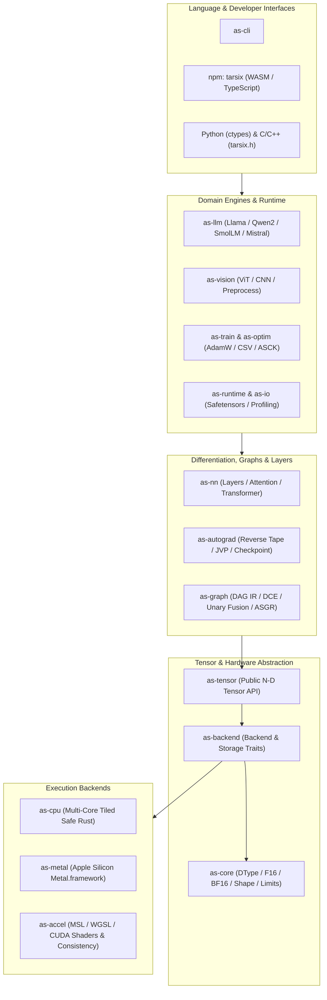

<div align="center">

# TARSIX

**Independent, Zero-Dependency, Memory-Safe AI Computing Infrastructure**

[](https://github.com/Xaynxofficial/tarsix/actions/workflows/ci.yml)
[](https://www.npmjs.com/package/tarsix)
[](Cargo.toml)
[](SECURITY.md)
[](Cargo.toml)
[](LICENSE)

*Written from scratch in Rust — N-D Tensors, Computational Graphs, Autograd, Neural Networks, Training, Safetensors, Multi-Architecture LLMs, Computer Vision, Apple Silicon Metal GPU, 114 KiB WebAssembly, Python & C/C++ ABI.*

[Architecture](#architecture) · [Core Capabilities](#core-capabilities) · [Security Model](#security--reliability) · [Quick Start](#quick-start) · [Benchmarks](#benchmarks) · [Crates](#workspace-crates)

</div>

---

## Overview

**Tarsix** is a self-contained AI computation, training, and inference ecosystem built without wrapping PyTorch, TensorFlow, ONNX Runtime, BLAS, or third-party tensor crates.

Modern AI stacks routinely carry gigabytes of Python runtimes, hundreds of transitive dependencies, and C/C++ memory-safety liabilities when parsing untrusted weights. Tarsix is engineered around four strict principles:

1. **Zero-Dependency Core** — All 16 core Rust crates compile with zero external dependencies, eliminating transitive supply-chain risk.
2. **Memory-Safe & Panic-Free** — Workspace-wide `#![forbid(unsafe_code)]` in core crates, Clippy-enforced denial of `unwrap`, `expect`, and `panic`, and release-mode integer overflow checks (`overflow-checks = true`).
3. **Untrusted-Input Hardening** — External model weights, graphs, CSVs, and images are validated against explicit `MemoryLimits`, rank ceilings, recursion caps, and cryptographic-style integrity checksums before allocation.
4. **Single Core, Universal Targets** — One Rust computation foundation powering native Rust services, Apple Silicon Metal GPUs, a **40 kB gzipped (114 KiB raw)** WebAssembly npm package (`tarsix`), Python (`ctypes`), and C/C++ (`tarsix.h`).

---

## Architecture

Tarsix enforces a strict acyclic workspace hierarchy separating mathematical semantics, graph compilation, runtime execution, and hardware dispatch:



---

## Core Capabilities

| Subsystem | Key Engineering Features |
| :--- | :--- |
| **Tensor Engine** | N-dimensional tensors, zero-copy `Shape`/`Stride`/`Offset` view algebra (`transpose`, `permute`, `slice`, `reshape`, `broadcast_to`), independent IEEE-754 `F16` & `BF16` (round-to-nearest-even, exhaustively verified across all 65,536 bit patterns), `F32`, `F64`, `I32`, `I64`. |
| **Computational Graph** | Iterative Kahn topological scheduler with cycle detection, Dead-Code Elimination (DCE), single-pass Unary Operation Fusion (`FusedUnaryChain`), liveness-based intermediate buffer release, checksummed `ASGR` binary serialization. |
| **Automatic Differentiation** | Panic-free reverse-mode `Tape` with broadcast unbroadcasting, differentiable `im2col`/`col2im`, multi-step gradient accumulation, just-in-time recomputing **gradient checkpointing**, forward-mode `DualTensor` (JVP), and central finite-difference `gradcheck`. |
| **Neural Networks & Training** | Deterministic `Xoshiro256++` PRNG, `Linear`, `Embedding`, `LayerNorm`, `RmsNorm`, `Dropout`, `Conv2d`, `MultiHeadAttention`, `TransformerBlock`, `Sgd`/`Adam`/`AdamW`, `StepLr`/`CosineAnnealingLr`, global L2 gradient clipping, CSV dataset I/O, and checksummed `ASCK` checkpoints. |
| **Model Interoperability & Runtime** | Recursion-bounded JSON parser, zero-dependency **Safetensors** reader/writer (`F32/F64/F16/BF16/I32/I64`), `InferenceSession` with graph optimization, latency profiling, dynamic request batching, and streaming step execution. |
| **LLM Engine** | Multi-architecture HuggingFace loader (`Llama-2/3`, `Qwen2/2.5`, `SmolLM/SmolLM2`, `Mistral`, `TinyLlama`), Grouped-Query Attention (GQA), RoPE, bounded `KvCache`, HuggingFace `tokenizer.json` BPE & `ByteTokenizer`, Int8 per-channel `QuantizedLinear`, and Temperature/Top-k/Top-p streaming generation. |
| **Computer Vision** | Validated `ImageBuffer`, bilinear resizing, ImageNet CHW normalization, `PatchEmbed`, bidirectional `VisionTransformer` (ViT), `max_pool2d`, and end-to-end trainable `CnnClassifier`. |
| **Hardware Acceleration** | Multi-core `std::thread::scope` cache-blocked CPU GEMM (100% safe Rust), isolated Apple Silicon `Metal.framework` GPU backend (`as-metal`), versioned MSL/WGSL/CUDA kernel sources, and differential cross-backend numerical consistency testing (`as-accel`). |

---

## Security & Reliability

Tarsix treats every external model file, serialized graph, dataset, and shape header as **untrusted input** (see [SECURITY.md](SECURITY.md)):

| Threat Class | Mitigation Enforced |
| :--- | :--- |
| Memory corruption & data races | `#![forbid(unsafe_code)]` across all 16 core crates; narrow audited FFI only in `as-metal` & `as-wasm`. |
| Runtime panics / DoS crashes | Workspace Clippy denies `unwrap_used`, `expect_used`, `panic`; all fallible APIs return `Result<T>`. |
| Integer overflow in shape/stride math | `overflow-checks = true` in release profile + `checked_mul`/`checked_add` everywhere. |
| OOM allocation bombs | Pre-allocation `MemoryLimits` (`max_tensor_bytes`, `MAX_RANK = 16`, `MAX_IMAGE_DIM = 16_384`). |
| Crafted Safetensors / JSON payloads | Header byte cap (`16 MiB`), `MAX_JSON_DEPTH = 32`, overlapping `data_offsets` rejection, path-traversal blocking on shards. |
| Corrupted or tampered weights/graphs | Mandatory FNV-1a 64-bit integrity checksums on `ASGR` graphs and `ASCK` checkpoints (no unsafe pickle/RCE formats). |

---

## Quick Start & Usage Guides

### 1. Using Tarsix in Rust Code (`Tensor` & `Autograd`)

Add the crates you need from this workspace (or git URL) to your `Cargo.toml`:

```toml
[dependencies]
as-tensor   = { git = "https://github.com/Xaynxofficial/tarsix" }
as-autograd = { git = "https://github.com/Xaynxofficial/tarsix" }
```

```rust
use as_autograd::Tape;
use as_tensor::{DType, Result, Tensor};

fn main() -> Result<()> {
    // 1. Tensor creation, broadcasting & multi-core tiled MatMul
    let a = Tensor::from_f32(&[1.0, 2.0, 3.0, 4.0], vec![2, 2])?;
    let b = Tensor::from_f32(&[5.0, 6.0, 7.0, 8.0], vec![2, 2])?;
    let bias = Tensor::from_f32(&[1.0, -2.0], vec![1, 2])?;
    let out = a.matmul(&b)?.add(&bias)?;
    println!("MatMul + bias = {:?}", out.to_f32_vec()?); // [20.0, 20.0, 44.0, 48.0]

    // 2. Automatic Differentiation (Reverse-Mode Tape)
    let mut tape = Tape::new();
    let x = tape.var(Tensor::from_f64(&[2.0, 3.0], vec![1, 2])?, true);
    let w = tape.var(Tensor::from_f64(&[0.5, -1.0], vec![2, 1])?, true);
    let y = tape.matmul(x, w)?;
    let loss = tape.powf(y, 2.0)?;
    let grads = tape.backward(loss)?;
    println!("dL/dw = {:?}", grads.get(w).unwrap().to_f64_vec()?);
    Ok(())
}
```

### 2. Training & Predicting from the Terminal (`as-cli`)

Clone the repo and run commands directly — no Python environment required:

```bash
git clone https://github.com/Xaynxofficial/tarsix.git
cd tarsix

# Verify all 37 unit, numerical, gradcheck, and security tests
cargo test --workspace

# Show detected CPU/GPU hardware & security posture
cargo run --release -p as-cli -- info
```

**Prepare your own CSV dataset** (numeric feature columns, last column = integer class `0, 1, 2...`):
```csv
height_m,weight_100kg,label
1.80,0.52,0
1.75,0.68,1
1.70,0.92,2
```

**Train, save a checksummed `.asck` model, and run live predictions:**
```bash
# Or generate a ready-to-use 240-sample 3-class CSV dataset
cargo run --release -p as-cli -- make-dataset /tmp/data.csv 240

# Train (80% train / 20% validation split, AdamW + CosineAnnealingLr + grad clipping)
# Usage: train <data.csv> <out.asck> [epochs] [hidden_units]
cargo run --release -p as-cli -- train /tmp/data.csv /tmp/model.asck 80 24

# Predict on new unseen inputs
cargo run --release -p as-cli -- predict /tmp/model.asck "0.1,0.1"
```

**Train a mini Causal Transformer from scratch & chat:**
```bash
cargo run --release -p as-cli -- demo-chat $'S: merhaba\nC:'
```

### 3. Running Real HuggingFace LLMs (Llama / Qwen2 / SmolLM / Mistral)

```bash
# 1. Download a compact Safetensors model (e.g., SmolLM2-135M-Instruct, ~270 MB)
mkdir -p /tmp/smollm2 && cd /tmp/smollm2
curl -LO https://huggingface.co/HuggingFaceTB/SmolLM2-135M-Instruct/resolve/main/config.json
curl -LO https://huggingface.co/HuggingFaceTB/SmolLM2-135M-Instruct/resolve/main/tokenizer.json
curl -LO https://huggingface.co/HuggingFaceTB/SmolLM2-135M-Instruct/resolve/main/model.safetensors

# 2. Run streaming autoregressive generation directly with Tarsix
cd /path/to/tarsix
cargo run --release -p as-cli -- run-llm /tmp/smollm2 "Artificial intelligence is" 40 0.7
```

### 4. TypeScript / JavaScript (`npm install tarsix`)

Works in **Node.js (>=18)** and **Web Browsers** with the **114 KiB** WebAssembly engine bundled — zero external dependencies, no Rust or Python required:

```bash
npm install tarsix
```

```ts
import { createEngine, Tensor } from "tarsix";

const engine = await createEngine();
const a = Tensor.fromF32(engine, [1, 2, 3, 4], [2, 2]);
const b = Tensor.fromF32(engine, [5, 6, 7, 8], [2, 2]);
const bias = Tensor.fromF32(engine, [1, -2], [1, 2]);

const out = a.matmul(b).add(bias);
console.log(out.toF32Array()); // Float32Array(4) [ 20, 20, 44, 48 ]

a.dispose(); b.dispose(); bias.dispose(); out.dispose();
```

### 5. Python (`ctypes`) & C / C++ (`include/tarsix.h`)

Calls the native multi-core Rust library directly via C ABI with zero `pip` dependencies:

```bash
# Build native shared library (target/release/libas_wasm.dylib | .so | .dll)
cargo build -p as-wasm --release

# Run Python example
python3 sdk/python/tarsix.py
```

```python
from sdk.python.tarsix import Tensor

a = Tensor.from_list([1.0, 2.0, 3.0, 4.0], [2, 2])
b = Tensor.from_list([5.0, 6.0, 7.0, 8.0], [2, 2])
print((a @ b).to_list())  # [19.0, 22.0, 43.0, 50.0]
```

**C / C++** (full runnable example in [`examples/cpp_basic.cpp`](examples/cpp_basic.cpp)):

```bash
# Build native library & compile C++ example
cargo build -p as-wasm --release
clang++ -std=c++17 examples/cpp_basic.cpp -Iinclude -Ltarget/release -las_wasm -Wl,-rpath,target/release -o /tmp/tarsix_cpp
/tmp/tarsix_cpp
# Output: C++ -> Native Rust Tarsix result: [20.0, 20.0, 44.0, 48.0]
```

---

## Benchmarks

Reproducible measurements collected via `cargo run --release -p as-bench` on **Apple Silicon (`aarch64` / macOS, 8 threads, 100% safe Rust, zero external BLAS)**:

| Workload | Median (ms) | Mean (ms) | P95 (ms) | Throughput |
| :--- | ---: | ---: | ---: | ---: |
| `add_f32_contiguous_1M` | 0.235 | 0.207 | 0.240 | **50.98 GB/s** |
| `add_f32_broadcast_1024x1024` | 0.149 | 0.150 | 0.196 | **56.38 GB/s** |
| `matmul_f32_256x256` | 0.492 | 0.528 | 0.800 | **68.15 GFLOP/s** |
| `matmul_f32_512x512` | 3.870 | 3.831 | 5.203 | **69.37 GFLOP/s** |

*All performance claims are strictly tied to reproducible workloads in [`crates/as-bench`](crates/as-bench).*

---

## Workspace Crates

<details>
<summary><strong>Inspect all 18 crates & SDKs</strong></summary>

- `crates/as-core` — Core types, errors, `MemoryLimits`, `F16`/`BF16`, `Shape`, `Layout`
- `crates/as-backend` — `Backend` and `Storage` hardware abstraction traits
- `crates/as-cpu` — Safe multi-core tiled CPU execution engine
- `crates/as-metal` — Apple Silicon `Metal.framework` GPU backend
- `crates/as-tensor` — Public `Tensor<B>` Rust API
- `crates/as-graph` — Computational graph IR, DCE, Unary Fusion, `ASGR` codec
- `crates/as-autograd` — Reverse-mode `Tape`, checkpointing, forward-mode `DualTensor`, `gradcheck`
- `crates/as-nn` — Neural network layers, activations, losses, attention, Transformer
- `crates/as-optim` — `Sgd`, `Adam`, `AdamW`, LR schedulers, gradient clipping
- `crates/as-train` — `Dataset`, `DataLoader`, CSV I/O, metrics, `ASCK` checkpoints
- `crates/as-io` — Bounded JSON parser, Safetensors reader/writer, `ModelConfig`
- `crates/as-runtime` — `InferenceSession`, profiling, dynamic batching, streaming
- `crates/as-llm` — Multi-architecture LLM decoder, GQA, RoPE, KV-Cache, BPE, Int8 quantization
- `crates/as-vision` — Image preprocessing, `PatchEmbed`, `VisionTransformer`, `CnnClassifier`
- `crates/as-accel` — Hardware discovery, MSL/WGSL/CUDA kernels, differential consistency harness
- `crates/as-wasm` — Zero-dependency WebAssembly & native C-ABI `cdylib`
- `crates/as-cli` — Command-line interface (`as-cli`)
- `crates/as-bench` — Zero-dependency statistical benchmark runner
- `sdk/typescript` — Published `tarsix` npm package
- `sdk/python` & `include/tarsix.h` — Python `ctypes` & C/C++ bindings

</details>

---

## Architecture Decision Records

- [ADR-001: Language Selection and Modular Workspace Architecture](docs/adr/ADR-001-language-and-workspace-architecture.md)
- [ADR-002: Memory Safety, Panic-Free APIs, and Untrusted-Input Security Model](docs/adr/ADR-002-memory-safety-and-security-model.md)
- [ADR-003: Tensor Layout, Zero-Copy Views, and Independent Half-Precision Types](docs/adr/ADR-003-tensor-layout-and-dtype-system.md)
- [ADR-004: Computational Graph IR, Operation Fusion, and Panic-Free Autodiff Tape](docs/adr/ADR-004-graph-and-autograd-architecture.md)

---

## Contributing & License

Contributions are welcome — please review [CONTRIBUTING.md](CONTRIBUTING.md) and [SECURITY.md](SECURITY.md) before opening a pull request.

Licensed under the **Apache License, Version 2.0** ([LICENSE](LICENSE)).
